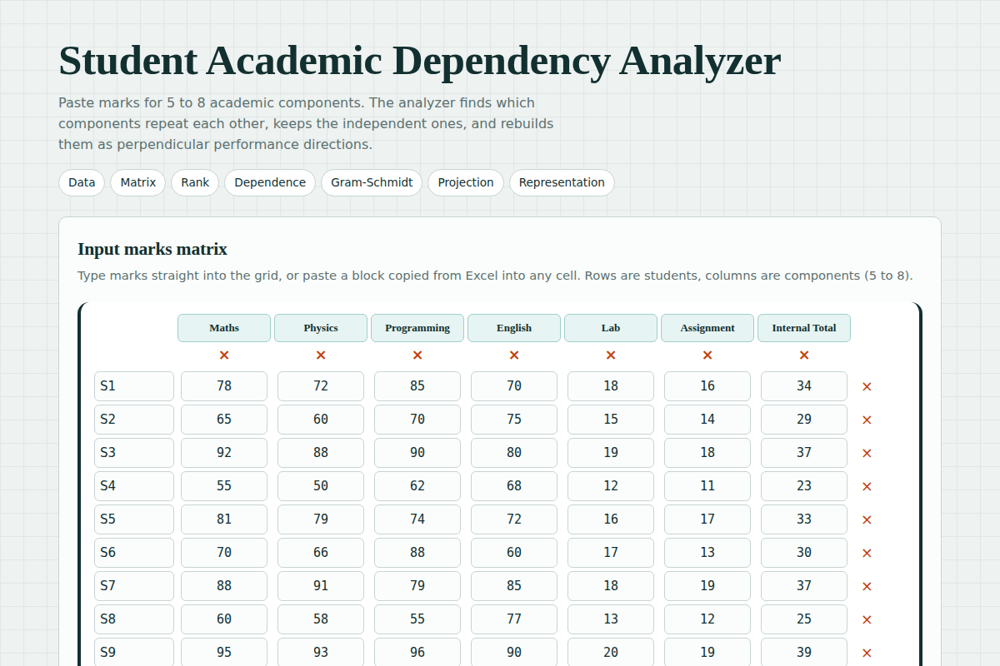
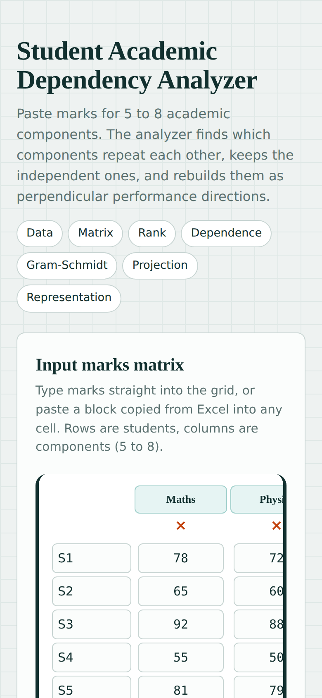

# Student Academic Dependency Analyzer

Linear Algebra & Vector Calculus mini-project. A Flask website that finds which academic components are redundant and rebuilds the independent ones as orthogonal performance directions.

**Pipeline:** Academic data → Matrix → Rank → Linear dependence/independence → Gram-Schmidt → Projection → Performance representation

## Features
- Editable marks matrix (5 to 8 components), with Excel paste and CSV import
- Rank and pivot columns from my own Gauss-Jordan elimination
- Dependent components written as combinations of independent ones
- Gram-Schmidt implemented from scratch, with an orthonormal basis Q and coordinates R = QᵀA
- Projection of overall performance, with the share explained by each direction
- Verification: rank vs NumPy, ‖QᵀQ − I‖, ‖QR − A‖, residual perpendicular to the basis

## Run
```bash
pip install -r requirements.txt
python app.py
```
Open http://127.0.0.1:5000

## Screenshots



## Notes
Marks are used raw (not mean-centred). Gram-Schmidt results depend on column order. A tolerance decides when a pivot counts as zero.
